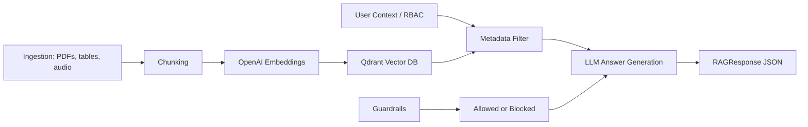

# Enterprise RAG + RBAC

Production-style starter for a multimodal enterprise RAG system with role-based access control, metadata-aware Qdrant retrieval, guardrails, FastAPI serving, and evaluation hooks.


## Architecture



## What is included

- Multimodal ingestion for PDFs, tables, and audio transcripts
- Config-backed chunking with preserved metadata
- OpenAI embedding pipeline for Qdrant insertion
- RBAC-aware retrieval using pre-search Qdrant filters
- Guardrail checks for salary, prompt injection, and off-topic prompts
- FastAPI `/chat` endpoint with mock JWT verification
- Ragas evaluation script and CSV reporting
- Docker, Docker Compose, and CI coverage checks

## How to run

1. Create and activate a Python environment.
1. Install dependencies:

```bash
pip install -r requirements.txt
```

1. Copy the example env file and set your keys:

```bash
copy .env.example .env
```

1. Start Qdrant and the API with Docker:

```bash
docker compose up --build
```

1. Or run the API locally:

```bash
uvicorn src.main:app --reload
```

1. Run the test suite:

```bash
pytest
```

1. Generate the evaluation report:

```bash
python -m src.evaluation
```

## Environment variables

- `OPENAI_API_KEY`
- `QDRANT_URL`
- `QDRANT_HOST`
- `QDRANT_PORT`
- `QDRANT_API_KEY`
- `QDRANT_COLLECTION_NAME`
- `GUARDRAILS_CONFIG_DIR`
- `CHUNK_SIZE`
- `CHUNK_OVERLAP`

## Results

The evaluation script writes per-question scores to `reports/eval_report.csv` and prints a summary to the terminal.

| Metric | Value |
| --- | --- |
| Average faithfulness | Run `python -m src.evaluation` and read the summary output |
| Estimated hallucination rate | `100% - average faithfulness` |
| Unauthorized queries correctly blocked | Run the manual RBAC checks across HR, Engineering, Finance, and Admin users |

For resume use, copy the final numbers from the generated CSV and terminal summary after running the evaluation script against your configured model.

## Project structure

- `src/` application code
- `configs/guardrails/` NeMo Guardrails config
- `data/` evaluation samples
- `reports/` generated metrics
- `tests/` unit and integration tests
